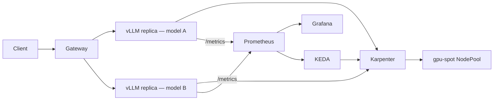

# llm-inference-platform-eks

A production-shaped LLM inference platform on EKS: vLLM behind a model-router gateway, autoscaling on inference-native signals (queue depth, KV-cache pressure), full observability, and cost-per-token accounting.

## Architecture



_Diagram is a placeholder — replace once the gateway and chart exist._

## Quickstart

```bash
make up          # provision cluster + deploy vllm + gateway
make load-test   # run llmperf against the endpoint
make down        # tear down workloads
make destroy-check
```

Nothing is implemented yet — this is Week 0 scaffolding.

## Repo layout

```
terraform/       vpc, eks, karpenter, irsa
charts/vllm/      vLLM helm chart
gateway/          model-name router (OpenAI-compatible)
keda/             scaledobjects
monitoring/       dashboards json, prometheusrules
benchmarks/       csv results + plots + methodology.md
docs/
  slo.md          latency/availability SLOs + error budget policy
  runbooks/        symptom → cause → fix
  deep-dives/      routing tier, KV-cache math, etc.
  decisions/       ADRs
```

## Benchmarks

| Scenario | Throughput | p95 TTFT | Scale-out time | $/1M tokens |
|---|---|---|---|---|
| _pending_ | — | — | — | — |

## Design decisions

ADRs land in `docs/decisions/` as they're made.

## Cost notes

Everything under `make up` is 💰. Nothing runs overnight; NodePool GPU limits stay capped; `make destroy-check` runs before closing the laptop.
